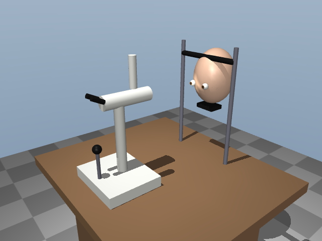
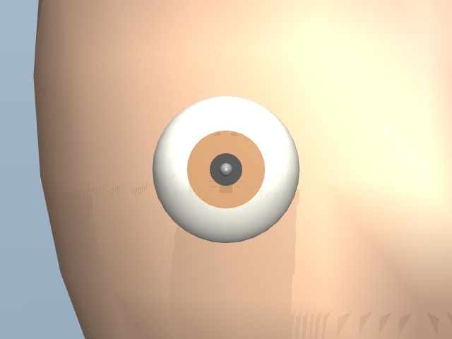
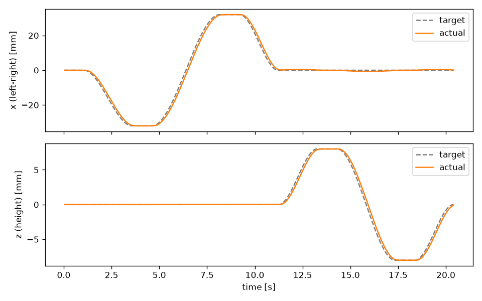

# 進捗まとめ：M0〜M1（2026-10-10 〜 10-11）

PAI最終課題「模倣学習による細隙灯アライメントロボット（MuJoCo）」の、M0（環境とシーン）から M1（連動拘束・アーム・IK・把持）までの記録。
計画全体は `../../PLAN.md`、各段階の用語と式の解説は [解説_M0.md](解説_M0.md)・[解説_M1.md](解説_M1.md) を参照。

---

## 0. 全体像：いまどこまで来たか

| # | 内容 | 予定 | 状況 |
|---|---|---|---|
| M0 | Docker環境、シーン（MJCF）作成 | 10/10–10/12 | ✅ 完了（10/10） |
| M1 | 連動拘束＋アーム＋IK、握った状態で操作 | 10/13–10/16 | ✅ 完了（10/11、予定より5日早い） |
| M2 | 先生（特権情報＋P制御）の閉ループ制御＋デモ自動収集 | 10/17–10/19 | 未着手 |
| M3 | BC学習 → 生徒が画像だけで操作 → DAgger（**合格ライン**） | 10/20–10/25 | 未着手 |
| M4 | 拡張（任意） | 10/26–10/28 | 未着手 |
| M5 | 動画・レポート・GitHub | 10/29–11/01 | 未着手 |

締切：**2026-11-02 AM10:00**

```
【M0〜M1で完成した部分】
指令「本体を x, z へ」 → ジョイスティック角 → IK → アーム6関節 → (weld) → ジョイスティック → (連動拘束) → 細隙灯本体
                                                                                              ↓
                                                                                    細隙灯カメラの画像

【M2以降で作る部分】
細隙灯カメラの画像 → 先生(M2) / 生徒AI(M3) → 指令「本体を x, z へ」
```

---

## 1. 計画の見直し（v1 → v2）

### 1.1 何を変えたか
| | v1 | v2（現行） |
|---|---|---|
| AIの役割 | 画像から瞳孔を検出するだけ（CNN） | **画像を見てジョイスティック操作を決める（模倣学習ポリシー）** |
| 操作の決め方 | 人が設計した数式（P制御） | 数式は「先生」役。生徒AIがそれを真似て学ぶ |
| 評価の軸 | 瞳孔検出の誤差 | 先生（古典制御）vs 生徒（BC）vs 生徒（BC＋DAgger） |

### 1.2 なぜ変えたか
- 講義第1回スライド p.26〜30 に「**本講座の中心＝強化学習（PPO・SAC）と模倣学習（BC・Diffusion Policy・VLA）**」と書かれている。古典制御（IK/FK・MPC）は「ポリシーを手で設計する」側として、対比の位置にある。
- v1 は「知覚だけAI＋古典制御」で、Physical AI の最終課題としては「ポリシーを学習していない」と評価されるおそれがあった。
- v2 では、先生（シミュレータだけが知る眼の真の位置を使うP制御）のお手本を自動で集め、生徒が**画像 → 操作**を学ぶ。講義 p.29 の「E2E（画像から行動まで一続き）」の論点を、自分のタスクで検証できる。

---

## 2. M0：Docker環境とシーン

### 2.1 Docker環境
**なぜ Docker か**：Windows で直接 `import mujoco` すると、スマートアプリコントロールにDLLをブロックされる（設定は変更しない方針）。Linuxコンテナの中なら問題なく動く。

```
Windows（コード編集・画像/動画の確認）
 └ Docker コンテナ（Python 3.12 / MuJoCo 3.15.0 / PyTorch 2.11 CPU版 / OpenCV）
    └ MuJoCo（models/scene.xml を読み込んだ仮想診察室）
```

| ファイル | 内容 |
|---|---|
| `Dockerfile` | Python 3.12-slim、描画用ライブラリ（EGL・OSMesa）、ffmpeg、CPU版PyTorch を導入 |
| `requirements.txt` | mujoco==3.15.0、numpy、opencv-python-headless、imageio(+ffmpeg)、matplotlib |
| `compose.yaml` | サービス名 `sim`、フォルダを `/workspace` にマウント、`MUJOCO_GL=egl`、`PYTHONPATH=/workspace` |
| `.dockerignore` | outputs/・data/・report/ を設計図に含めない |

- PC：Docker 29.8、CPU 32コア、メモリ16GB。ビルド時間は約2分。
- **ヘッドレス描画**：画面のないコンテナ内で、EGL（Mesaのソフトウェア描画）を使って画像を作る。そのまま動作した（OSMesa への切替は不要だった）。

### 2.2 シーン（models/scene.xml）
座標系：x＝検者から見て右、y＝患者側（奥）、z＝上。単位は m。

| 部品 | 位置・寸法 | 動き（joint） |
|---|---|---|
| 診察台 | 天板上面 z=0.75 | 固定 |
| 細隙灯 基台 | (0, −0.10, 0.75) | `lamp_x` 左右 ±60mm、`lamp_y` 前後 ±40mm |
| ジョイスティック | 基台の手前、ノブは z≈0.90 | `js_pitch` 前後傾 ±20°、`js_roll` 左右傾 ±20°、`js_spin` 軸回転 ±360° |
| 支柱・鏡筒 | 光軸の高さ z=1.05 | `lamp_z` 上下 ±30mm |
| 細隙灯カメラ `slit_cam` | 鏡筒の先端、+y を向く、fovy=15° | 鏡筒と一緒に動く |
| 細隙光 | 鏡筒の横からスポットライト | 鏡筒と一緒に動く |
| 顎台・頭部 | 頭の中心 (0, 0.32, 1.05) | 固定 |
| 眼球 | 右眼 x=−32mm、左眼 x=+32mm（瞳孔間距離64mm） | 固定 |
| 眼の寸法 | 眼球の半径12mm、虹彩の半径6mm、瞳孔の半径2.5mm | — |
| 瞳孔中心の目印 | `pupil_R_center` / `pupil_L_center`（site） | M2で先生が使う「真の位置」 |
| 俯瞰カメラ `overview` | 斜め上から全体を見る | 固定 |

- 患者は −y を向いているので、**患者の右眼は x<0 側（検者から見て左）**。対面診察と同じ見え方。

### 2.3 M0の成果物
| ファイル | 内容 |
|---|---|
| `outputs/m0_*_overview.png`, `m0_*_slit_cam.png` | 中央／右眼に合わせた状態の静止画 |
| `outputs/m0_orbit.mp4` | 周回カメラ＋細隙灯カメラの2画面（8秒）。細隙灯が右眼→左眼→右眼と往復 |




### 2.4 「試してみよう」の結果
| 実験 | スクリプト | 結果・考察 |
|---|---|---|
| fovy 15° → 8° | `try_m0.py` → `m0_try_fovy15_vs_8.png` | 眼は約2倍に写る（画面の高さの約4割→約8割）。見える縦幅は 15°で約55mm、8°で約29mm（カメラから眼まで約0.21m）。**倍率を上げると精度は上がるが、ずれが大きいと眼が画面から外れて見失う** → 当面 15° を採用 |
| 仰角 −20° → −60° | `try_m0.py` → `m0_try_elev60_orbit.mp4` | 前後の距離関係はわかりやすいが、高さの動きは見えにくい |
| ズーム と 前進 の比較 | `try_zoom_vs_forward.py` → `m0_try_zoom_vs_forward.mp4` | **ズーム（fovy変更）では本体は動かない**。本体を40mm前進させると眼はやや大きく写る。シミュレータのカメラはピンホールなので**ピントが常に合い、ボケない** → 実機の「近づくとボケる」効果は、拡張（M4）でぼかし処理を加えて再現する |

### 2.5 M0でのつまずき
| 症状 | 原因 | 対策 |
|---|---|---|
| 瞳孔の周りに白い輪 | 虹彩の円盤が眼球の球面より奥にあり、球が突き抜けて見えた | 虹彩・瞳孔を 1mm 前（角膜側）へ |
| 細隙光が額に当たる | 光の向き `dir` が水平だった | 光源→眼の方向ベクトルを計算し直した（`dir="-0.2 1 -0.17"`） |
| 細隙光で虹彩が白く飛ぶ | 光が強すぎた | 明るさを 0.9 → 0.4 |

---

## 3. M1：連動拘束・アーム・IK・把持

### 3.1 Step 1：連動拘束（ジョイスティック → 本体）
MuJoCo の `<equality><joint polycoef>` で「関節A ＝ 係数 × 関節B」を課した。

| ジョイスティック | 本体 | 係数 | 例 |
|---|---|---|---|
| 左右傾き `js_roll` | 左右 `lamp_x` | +0.15 m/rad | 10°倒すと 26mm |
| 前後傾き `js_pitch` | 前後 `lamp_y` | −0.15 m/rad | 奥へ押すと奥へ（今回は使わない） |
| 軸回転 `js_spin` | 高さ `lamp_z` | +0.00318 m/rad | 半回転で 10mm |

- 符号は右ねじの法則で決めた（y軸まわりに＋回すとノブは＋x＝右へ倒れる）。
- **簡略化**：実機は大きな移動を台ごと滑らせ、傾きは微調整に使う。本プロジェクトは「傾き角＝位置」に一本化した。
- 検証：仮のモーターでジョイスティックを直接動かす `models/test_linkage.xml` ＋ `scripts/m1_step1_linkage.py`。

**検証結果（修正後）**
| 区間 | 傾き/回転 | 本体の変位 | 比 |
|---|---|---|---|
| 右へ10° | +10.01° | +26.21 mm | 0.1500 m/rad |
| 左へ10° | −10.01° | −26.21 mm | 0.1500 m/rad |
| ハンドル +180° | +180.0° | +9.99 mm | 0.00318 m/rad |
| ハンドル −180° | −180.0° | −9.99 mm | 0.00318 m/rad |

→ 設計値と一致した。

### 3.2 Step 2：ロボットアーム（医師の席側）
- 置き場所：ジョイスティックの手前、検者が座る位置（y=−0.45）に台座を置く（**ユーザー決定**）。
- **6関節**（当初案の5関節から変更）：

| 関節 | 軸 | 役割 | 可動範囲 |
|---|---|---|---|
| `a_yaw` | z | 土台の旋回 | ±90° |
| `a_shoulder` | x | 肩 | ±120° |
| `a_elbow` | x | 肘 | ±160° |
| `a_wrist_pitch` | x | 手首の曲げ | ±150° |
| `a_wrist_dev` | y | 手首の横曲げ（**追加**） | ±60° |
| `a_wrist_roll` | z | 手首の回転＝ハンドルを回す | ±270° |

- **5→6関節にした理由**：ジョイスティックを左右に倒すと、ノブが横に傾く。握ったままついていくには手先の「位置3つ＋向き3つ」＝6つの量を合わせる必要があり、関節も6つ要る。5関節では手とノブが引っ張り合う。
- 手首の3軸は1点で交わる（球面手首、人の手首と同じ構造）。
- リンク長：土台0.10m、上腕0.20m、前腕0.20m、手0.08m（握る点まで）。
- 手は「掌＋指2本」の簡単な形。握る点 `grip` は指の間。
- `gravcomp="1"`（自重の打ち消し）、位置制御モーター（kp=150、kv=15）。
- **衝突判定は全体で無効化**（`<flag contact="disable"/>`）。握る動作は weld で表すので不要で、計算も安定する。

### 3.3 Step 3：逆運動学（IK）
- `sim/arm_ik.py`：**減衰付き最小二乗法** Δq = Jᵀ (J Jᵀ + λ² I)⁻¹ e、λ=0.02。
  - e：手先の目標とのずれ（位置3＋向き3）。向きのずれは、回転行列の各列の外積の和の半分で近似する。
  - J：`mj_jacSite` で求めた 6×6 のヤコビアン（アームの6関節の列だけ使う）。
  - 1回の変化量は 0.2 rad までに制限し、関節の可動範囲で打ち切る。
- 握る向き：手は下向き、ノブの軸は上向きなので、x軸まわりに180°反転させた向きを目標にする。
- 結果：**位置誤差 0.001mm、角度誤差 0.000°**。関節角は [0, −20, −86.8, −73.2, 0, 0]°。

### 3.4 Step 4：把持（weld）と操作API
- `sim/slitlamp_api.py` の `SlitLampRobot`：
  - `grasp()`：IKで手をノブに置く → 「手から見たジョイスティックの相対姿勢」を weld に設定 → weld を ON。
  - `command(x, z)`：本体の目標位置 → ジョイスティック角（可動範囲で打ち切り）→ ノブの目標姿勢 → IK（前回の解から30回反復）→ モーター目標。
  - `knob_pose()`：ジョイスティックは基台に付いていて、倒すと基台ごと動く。そのため、計算専用のデータにジョイスティック角と**本体の移動分**を書き込み、順運動学でノブの位置を求める。
- **簡略化**：把持の動作（近づく・指を閉じる）は省略し、「握った状態」から開始する。
- **M3で学習するポリシーの出力は、この `command(x, z)` に渡す値になる。**

### 3.5 M1の完成デモ（`scripts/m1_demo.py`）
患者の右眼(−32mm) → 左眼(+32mm) → 中央 → 上(+8mm) → 下(−8mm) → 中央（20秒）。

| 指標 | 結果 |
|---|---|
| 指令への追従誤差 | 平均 **0.82 mm**、最大 **2.64 mm**（動いている最中の遅れ。止まると 0.00 mm） |
| 手とノブのずれ | 最大 **0.10 mm** |
| 連動の比 | 0.1500 / 0.00318 m/rad（設計値どおり） |



### 3.6 M1でのつまずき
| 症状 | 原因 | 対策 |
|---|---|---|
| 鏡筒が最初から下限（−30mm）まで落ちる | 鏡筒の重さを連動拘束だけで支えていた | 支柱・鏡筒・照明に `gravcomp="1"`（実機の高さ調整ネジが自重を支えるのに相当） |
| 傾き:移動 の比が 0.15 にならない（0.03〜1.7とばらつく） | 拘束が柔らかすぎ | 拘束の `solref="0.004 1"`（時定数を timestep の2倍まで小さく） |
| 連動テスト中に発散（NaN） | 軽いジョイスティックと重い本体が引っ張り合った | 上記2つで解消 |
| weld を ON にすると 0.4秒で発散（NaN、`js_pitch`） | ジョイスティック（約30g）が本体・アームに比べて軽すぎ、2ms刻みでは計算が追いつかない | **12通りのパラメータを比較**して、ジョイスティックの `armature` を 0.005→0.05、weld の `solref="0.01 1"` に決定 |

パラメータ比較の要点：
- timestep 1ms なら軽いままでも安定するが、計算が2倍遅くなる（M2のデモ収集で不利）ので不採用。
- armature 0.05 なら、2ms・どの硬さでも安定した。

### 3.7 M1の成果物
| ファイル | 内容 |
|---|---|
| `outputs/m1_step1_linkage.mp4` | 仮モーターで傾ける・回す → 本体が連動 |
| `outputs/m1_step3_grasp.png` | 握った状態（横・俯瞰・拡大） |
| `outputs/m1_demo.mp4` | 完成デモ：横から＋細隙灯カメラ |
| `outputs/m1_demo_top.mp4` | 完成デモ：真上から＋細隙灯カメラ（左右の動きが見やすい） |
| `outputs/m1_demo_log.csv` | 時刻ごとの目標・実際の位置、手とノブのずれ |
| `outputs/m1_demo_plot.png` | 目標と実際の位置のグラフ |

---

## 4. 現在のファイル構成
```
slitlamp_robot/
├ Dockerfile / compose.yaml / requirements.txt / .dockerignore
├ models/
│  ├ scene.xml          … 仮想診察室（細隙灯・患者・アーム・連動拘束・weld・モーター）
│  └ test_linkage.xml   … 連動テスト用（scene.xml＋ジョイスティック直結の仮モーター）
├ sim/
│  ├ arm_ik.py          … 逆運動学（減衰付き最小二乗法）
│  ├ slitlamp_api.py    … 指令(x,z) → ジョイスティック角 → IK → モーター、把持
│  └ viz.py             … カメラ（側面・真上・自由）、文字入れ、2画面合成
├ scripts/
│  ├ render_snapshot.py / render_orbit.py            … M0 静止画・周回動画
│  ├ try_m0.py / try_zoom_vs_forward.py              … M0 試してみよう
│  ├ m1_step1_linkage.py / m1_step3_ik.py            … M1 段階ごとの確認
│  └ m1_demo.py                                      … M1 完成デモ（--view side|top）
├ docs/
│  ├ 解説_M0.md / 解説_M1.md
│  └ 進捗まとめ_M0-M1.md（このファイル）
└ outputs/  … 画像・動画・ログ
```

## 5. よく使うコマンド（`slitlamp_robot` フォルダで）
```bash
docker compose build                                              # 環境を作る（Dockerfile変更時）
docker compose run --rm sim python scripts/render_snapshot.py     # M0 静止画
docker compose run --rm sim python scripts/render_orbit.py        # M0 周回動画
docker compose run --rm sim python scripts/m1_demo.py             # M1 デモ（横から）
docker compose run --rm sim python scripts/m1_demo.py --view top  # M1 デモ（真上から）
docker compose run --rm sim bash                                  # コンテナに入って作業
```

## 6. レポートに書くべき簡略化（実機との違い）
1. 把持動作は省略し、weld 拘束で「握った状態」から開始する。
2. ジョイスティックは「傾き角＝位置」の一本化（実機は台ごと滑らせる粗動＋傾きの微動）。
3. 衝突判定なし。
4. 鏡筒の自重は重力補償（gravcomp）で打ち消す。
5. カメラはピンホール（ボケない）。ピント合わせは拡張で後処理のぼかしにより再現予定。
6. 患者は合成CG（個人情報なし）。

## 7. 未解決・今後の課題
- 提出動画のカメラ構成：横からだと左右の傾きが見えず、真上からだと高さの動きとジョイスティックが見えない → 「真上＋横＋細隙灯カメラ」などの組み合わせを M5 で検討する。
- 細隙灯カメラの倍率：当面 fovy=15°。2段階（低倍率で大まかに → 高倍率で微調整）は拡張候補。
- 細隙光の照明が顔の一部で強く白飛びする場面がある（AIの入力画像として問題ないかは M2 で確認する）。
- `MUJOCO_LOG.TXT`（発散時に MuJoCo が出した警告ログ）は、解消済みのため 10/11 に削除した。

## 8. 次：M2（先生の自動アライメント＋お手本データ収集）
- 先生＝シミュレータだけが知る瞳孔の真の位置（`pupil_R_center`）と、鏡筒の光軸とのずれから、P制御で `command(x, z)` を出す。
- 頭の位置・照明・瞳孔径などをランダムに変えて数百回のエピソードを実行し、（細隙灯カメラ画像, 指令）のペアを保存する。
- 完成条件：先生による自動アライメント動画（**保険の提出ライン**）、デモデータ数万フレーム、20試行でほぼ100%成功。
